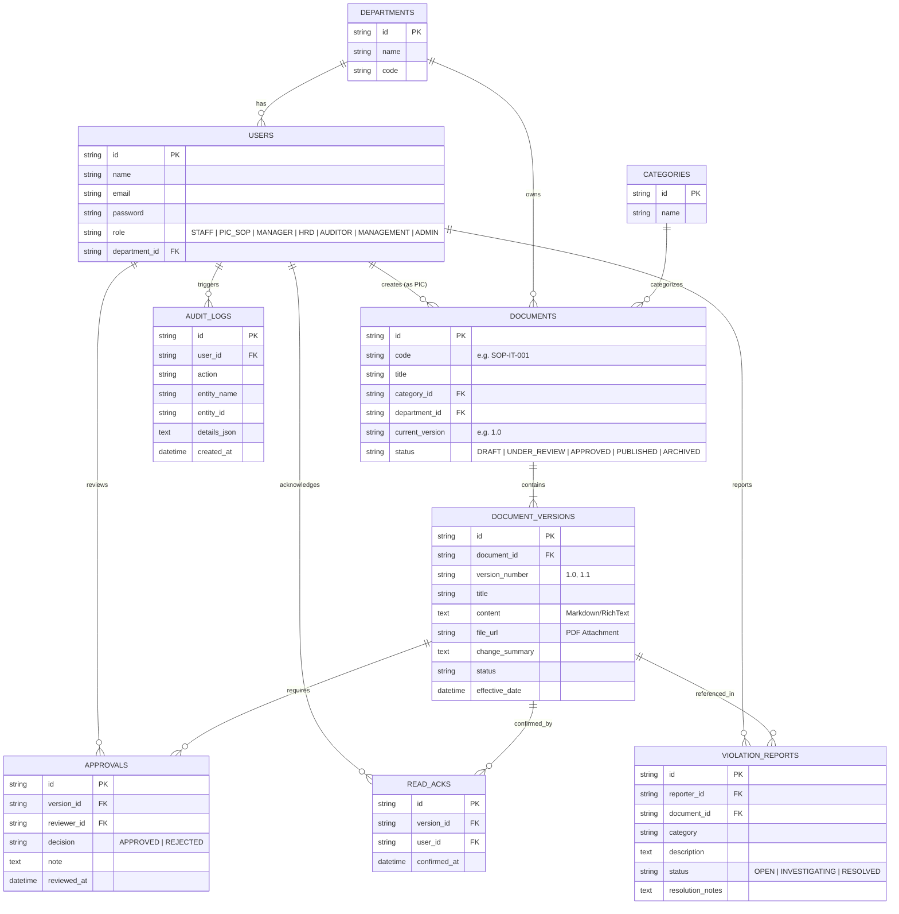

# Product Requirements Document (PRD)
## MING SOP Center - Internal SOP Management System

* **Status:** Approved / Finalized for Development
* **Versi:** 1.1.0
* **Tanggal Ditetapkan:** 19 November 2026
* **Target Penyelesaian:** 25 November 2026 (Timebox 1 Minggu)
* **Dokumen Referensi:** 
  * [Buku Panduan Teknis PDF](file:///C:/Users/vivy/Documents/github/sop-ming/docs/Tes%20Teknis%20Full%20Stack%20Programmer%20-%20MING%20SOP%20Center.pdf)
  * [Panduan Desain UI/UX (DESIGN.md)](file:///C:/Users/pgfe/Bitb/sop-ming/docs/DESIGN.md)
  * [PRD Desain & Spesifikasi Halaman (PRD_DESIGN.md)](file:///C:/Users/pgfe/Bitb/sop-ming/docs/PRD_DESIGN.md)

---

## 1. Pendahuluan & Latar Belakang

### 1.1 Problem Statement
Pengelolaan Standar Operasional Prosedur (SOP) saat ini menghadapi kendala desentralisasi:
1. **Penyebaran Informasi Terfragmentasi:** Dokumen SOP, catatan revisi, bukti sosialisasi, dan pelaporan kendala tersebar di berbagai saluran (chat, shared folders, email, kertas fisik).
2. **Risiko Ketidakpatuhan Versi:** Karyawan rentan menggunakan dokumen SOP yang sudah usang (*obsolete*) karena sulit memvalidasi versi resmi yang sedang aktif (*effective version*).
3. **Audit Trail Lemah:** Sulit menelusuri siapa yang mengubah draf, siapa yang menyetujui, kapan disosialisasikan, dan siapa saja karyawan yang sudah membaca/mengonfirmasi pemahaman SOP.
4. **Minimnya Visibilitas Manajemen:** Manajemen tidak memiliki dashboard terpusat untuk memantau status persetujuan tertunda (*bottleneck approval*), tingkat kepatuhan pembacaan SOP, maupun tren pelanggaran SOP.

### 1.2 Tujuan Produk (*Product Goals*)
Membangun platform web internal **MING SOP Center** yang menjadi sumber kebenaran tunggal (*Single Source of Truth*) untuk:
* Mengelola seluruh siklus hidup SOP (penyusunan, peninjauan, persetujuan, penerbitan, hingga pengarsipan).
* Memastikan distribusi dan sosialisasi SOP sampai ke karyawan terverifikasi lewat konfirmasi pembacaan (*Read Acknowledgment*).
* Menyediakan kanal pelaporan ketidakpatuhan / pelanggaran SOP secara terstruktur dan dapat ditindaklanjuti.
* Memberikan transparansi melalui *Audit Trail* menyeluruh dan *Executive Dashboard* untuk pengambilan keputusan cepat.

---

## 2. Pengguna & Hak Akses (Role-Based Access Control / RBAC)

Aplikasi memiliki 6 peran pengguna + 1 peran administratif:

| Role | Deskripsi & Tanggung Jawab Utama | Akses & Wewenang |
|---|---|---|
| **Karyawan (Staff)** | Pengguna umum yang menjalankan SOP harian. | Membaca SOP aktif, mencari SOP, mengonfirmasi baca (*acknowledgment*), membuat laporan pelanggaran/masalah SOP. |
| **PIC SOP** | Penanggung jawab teknis / penyusun dokumen SOP di departemen. | Membuat draf SOP baru, mengajukan revisi versi, melengkapi konten Markdown & upload lampiran PDF, memantau status draf miliknya. |
| **Manager** | Kepala bagian / reviewer yang bertanggung jawab atas validitas proses. | Meninjau draf (*review*), menyetujui (*approve*) atau mengembalikan dengan catatan revisi (*request changes/reject*). |
| **HRD / People Ops** | Pengelola sosialisasi perusahaan, pelatihan, dan kepatuhan umum. | Mengunggah pengumuman/sosialisasi, memantau *read rate* karyawan, mengelola materi kuis/evaluasi. |
| **Auditor / QA** | Penilai kepatuhan operasional dan independensi proses. | Akses *read-all* ke semua SOP (termasuk riwayat versi), memeriksa log aktivitas (*audit trail*), menindaklanjuti temuan pelanggaran. |
| **Manajemen** | Pengambil keputusan level strategis. | Dashboard analitik ringkas (approval tertunda, matriks kepatuhan departemen, status pelanggaran terbuka). |
| **Super Admin** | Pengelola teknis sistem. | Manajemen akun pengguna, pengaturan master departemen & kategori SOP. |

---

## 3. Pilihan Arsitektur & Tech Stack

Sesuai kesepakatan dan kebutuhan kemudahan pengujian bagi tim evaluator rekrutmen:

* **Frontend:**
  * **React 18 / 19** + **TypeScript**
  * **Vite** (Build tool super cepat, HMR responsif)
  * **Tailwind CSS** (Styling modern & responsif) + **Lucide React** (Iconography)
  * **Markdown / Rich Editor** (Editor konten terstruktur + pratinjau langsung)
  * **Role Switcher Demo Bar** (Memudahkan penguji berpindah antar peran dengan 1 klik tanpa harus logout-login berulang kali)

* **Backend:**
  * **Node.js** + **Express.js** + **TypeScript**
  * **Prisma ORM** dengan database **SQLite**
    * *Keunggulan Utama:* Evaluator dapat menjalankan aplikasi dengan perintah sederhana (`npm install`, `npx prisma db push`, `npm run dev`) tanpa perlu instalasi DBMS lokal tambahan seperti PostgreSQL/MySQL. Schema Prisma tetap 100% kompatibel untuk dialihkan ke PostgreSQL bila diperlukan ke production.
  * **JWT / Session Authentication** dengan enkripsi password `bcryptjs`.
  * **Multer** untuk upload file lampiran PDF dokumen SOP secara aman.

* **Format Konten SOP:**
  * **Hybrid Approach:** Konten SOP ditulis langsung menggunakan editor teks terstruktur (Markdown) di dalam sistem untuk keterbacaan cepat dan pencarian teks penuh, sekaligus mendukung pengunggahan lampiran file PDF resmi (tersedia fitur preview PDF dan unduh dokumen).

---

## 4. Scope & Prioritas Pengerjaan (MoSCoW Matrix)

### Phase 1: Core MVP (Fokus Utama Sprint 1)
1. **Autentikasi & RBAC:**
   - Login multi-role, proteksi endpoint API, demo role switcher bar.
2. **Master Data & Departemen:**
   - Kategori SOP (Operational, Finance, HR, IT, dll.) & Departemen.
3. **Siklus Hidup Dokumen SOP (Lifecycle Engine):**
   - Form pembuatan SOP baru oleh PIC.
   - Form revisi dan versioning (`v1.0` $\rightarrow$ `v1.1` $\rightarrow$ `v2.0`).
   - Alur persetujuan: `DRAFT` $\rightarrow$ `UNDER_REVIEW` $\rightarrow$ `APPROVED` $\rightarrow$ `PUBLISHED` $\rightarrow$ `ARCHIVED / OBSOLETE`.
   - Tindakan Manager: Review, Approve, atau Reject dengan catatan revisi wajib.
4. **Portal Katalog Karyawan & Konfirmasi Baca (Read Acknowledgment):**
   - Daftar SOP berstatus `PUBLISHED` dengan pencarian dan filter kategori/departemen.
   - Halaman detail SOP: membaca konten, unduh PDF lampiran, riwayat versi.
   - Tombol "Saya telah membaca dan memahami SOP ini" (pencatatan user, versi SOP, dan timestamp).
5. **Audit Trail Logging:**
   - Pencatatan otomatis setiap aksi penting ke tabel audit log yang bersifat *immutable*.

### Phase 2: High Value Extensions (Setelah Core MVP Stabil)
1. **Executive Dashboard & Kepatuhan:**
   - Ringkasan KPI: SOP aktif, pending approval, grafik kepatuhan konfirmasi baca per departemen.
2. **Pelaporan Masalah / Dugaan Pelanggaran SOP (*Incident Reporting*):**
   - Form pelaporan kendala/pelanggaran prosedur oleh staf/auditor.
   - Alur investigasi & status tindak lanjut: `OPEN` $\rightarrow$ `IN_INVESTIGATION` $\rightarrow$ `ACTION_TAKEN` $\rightarrow$ `RESOLVED`.
3. **Pengumuman & Sosialisasi SOP:**
   - Banner sosialisasi perubahan dokumen penting yang ditautkan ke detail SOP.

### Phase 3: Nice-to-Have (Waktu Tersisa)
1. Kuis / Evaluasi Pemahaman SOP singkat.
2. Fitur Export data audit trail ke Excel/PDF.

---

## 5. Rancangan Struktur Data & Database (Prisma Schema Outline)



---

## 6. Kebutuhan Pengujian & Kemudahan Evaluasi (Evaluator Experience)

1. **Database Seeder Otomatis:**
   - Menyediakan akun demo siap pakai untuk masing-masing peran (Karyawan, PIC SOP, Manager, HRD, Auditor, Management, Admin) dengan kata sandi terstandar (misal: `password123`).
   - Menyediakan sampel dokumen SOP realistis lintas departemen (IT, HR, Finance, Operational) dalam berbagai tahapan status (Draft, Pending Review, Published, Archived).
   - Menyediakan sampel audit trail dan riwayat approval.
2. **Setup Tanpa Hambatan:**
   - Cukup menjalankan:
     ```bash
     npm run setup    # install deps, migrasi DB, seeder
     npm run dev      # jalankan client & server serentak
     ```
3. **Dokumentasi Komprehensif:**
   - `README.md` berisikan panduan instalasi, akun demo, penjelasan arsitektur, asumsi teknis, dan bagian yang telah selesai serta rencana pengembangan.
