# Plan — Panduan Pengguna (halaman `/panduan`)

Status: **rencana, belum dikerjakan.** Menunggu arahan.
Ruang lingkup dokumen ini: konten panduan, aset screenshot, dan rencana implementasi halaman. **Tidak ada kode yang diubah.**
Basis desain: frame `11 Panduan Pengguna` (`0:1251`) dan `11b Panduan per peran` (`0:1359`) di `sop.fig`; pratinjau di `docs/design-preview/panduan.png` dan `panduan-per-peran.png`.

---

## 1. Tujuan

`README.md` adalah dokumentasi **untuk pengembang**: cara memasang, menjalankan, dan memahami keputusan teknis. Panduan Pengguna adalah dokumentasi **untuk pemakai**: apa yang harus diklik, dengan label tombol yang persis, sesuai peran.

Panduan ini juga menjawab satu butir brief yang belum dioptimalkan: *"Materi pembelajaran atau evaluasi pemahaman SOP dapat disediakan bila dianggap perlu."*

Bukan tujuan: CMS, editor konten, pencarian penuh-teks, versi bahasa Inggris, tombol cetak/PDF, atau video di dalam aplikasi.

---

## 2. Prinsip penulisan

1. **Satu artikel = satu tugas.** Maksimal 6 langkah; kalau lebih, pecah jadi sub-bagian.
2. **Sebut label tombol persis seperti di layar.** "Konfirmasi baca", bukan "tombol konfirmasi". "Buat versi baru", bukan "edit".
3. **Jangan mengarang fitur.** Tidak ada reset password mandiri, tidak ada unggah lampiran, tidak ada notifikasi, tidak ada penghapusan laporan. Batasan disebut sebagai catatan, bukan disembunyikan.
4. **Kalimat pendek, tanpa jargon.** "Versi terbit tidak bisa disunting langsung" lebih baik daripada "immutability diterapkan pada `SopVersion`".
5. **Screenshot harus memperlihatkan elemen yang disebut.** Jangan memakai tangkapan layar halaman penuh yang tombolnya tidak terlihat.
6. **Nada netral, bukan promosi.** Panduan menjelaskan, tidak menjual.

Pola setiap artikel:

```
[badge peran]  Judul tugas
1 kalimat tujuan
"Yang perlu diketahui" (opsional, maks 2 baris)
Langkah 1..n (bernomor)
[Screenshot]
Callout batasan (abu-abu, bukan kuning)
```

---

## 3. Struktur informasi

Delapan bagian, mengikuti daftar isi di desain. Semua bagian terlihat untuk semua peran; yang berbeda hanya penekanannya.

| # | Bagian | Untuk peran | Inti isi | Screenshot |
|---|---|---|---|---|
| 1 | Memulai | Semua | Login, menu menyesuaikan peran, pencarian, lupa password | 2 |
| 2 | Karyawan | Karyawan | Cari SOP terbit, baca, konfirmasi, lapor, pengumuman | 5 |
| 3 | PIC SOP | PIC SOP | Buat SOP, ajukan review, versi baru | 3 |
| 4 | Manager | Manager | Tinjau, setujui, tolak dengan alasan | 2 |
| 5 | HRD | HRD | Terbitkan, pengumuman, tindak lanjut laporan | 4 |
| 6 | Auditor | Auditor | Audit log, daftar pengguna, batas baca | 3 |
| 7 | Manajemen | Manajemen | Dashboard, daftar SOP, batas | 2 |
| 8 | Status & istilah | Semua | Arti 6 status + 5 istilah | 1 |

---

## 4. Rincian per bagian

### 4.1 Memulai — semua peran

**Tujuan:** pengguna bisa masuk dan tahu ke mana harus pergi.

**Isi:**

1. Buka `https://sopming.arnoldartworks.my.id`, masukkan email perusahaan dan password.
2. Menu di sidebar menyesuaikan peran; menu yang tidak relevan tidak ditampilkan.
3. Gunakan kotak pencarian di header untuk menemukan SOP lewat kode atau kata kunci.

**Callout:** "Lupa password? Hubungi HRD — di aplikasi ini tidak ada reset mandiri."

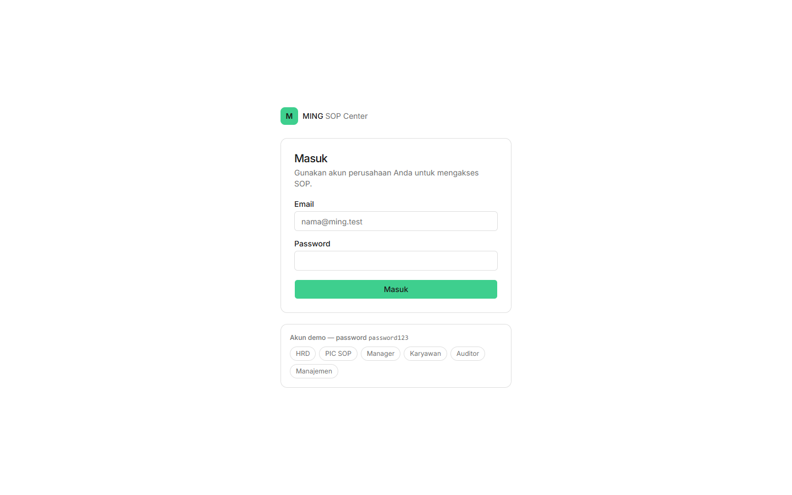

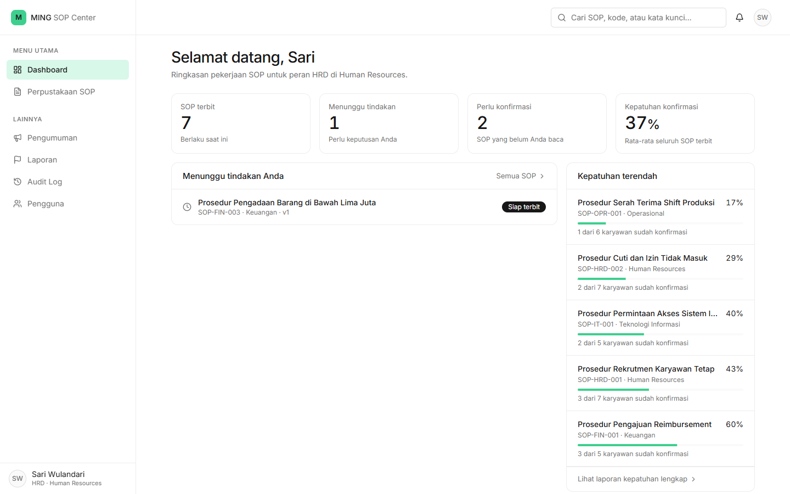

**Catatan penulisan:** jangan menyebut akun demo di dalam panduan pengguna. Akun demo hanya untuk penilai, dan sudah ada di README.

---

### 4.2 Karyawan — membaca dan mengonfirmasi

**Judul artikel (mengikuti desain):** "Membaca dan mengonfirmasi SOP"
**Badge:** Karyawan
**Tujuan:** karyawan tahu SOP mana yang wajib dibaca dan bagaimana konfirmasinya tercatat.

**Langkah:**

1. Buka **Perpustakaan SOP** dari sidebar.
2. Saring status **Terbit** untuk melihat SOP yang berlaku.
3. Buka SOP yang dibutuhkan; tab **Riwayat Versi** menampilkan versi sebelumnya.
4. Tekan **Konfirmasi baca** di kanan atas halaman detail.

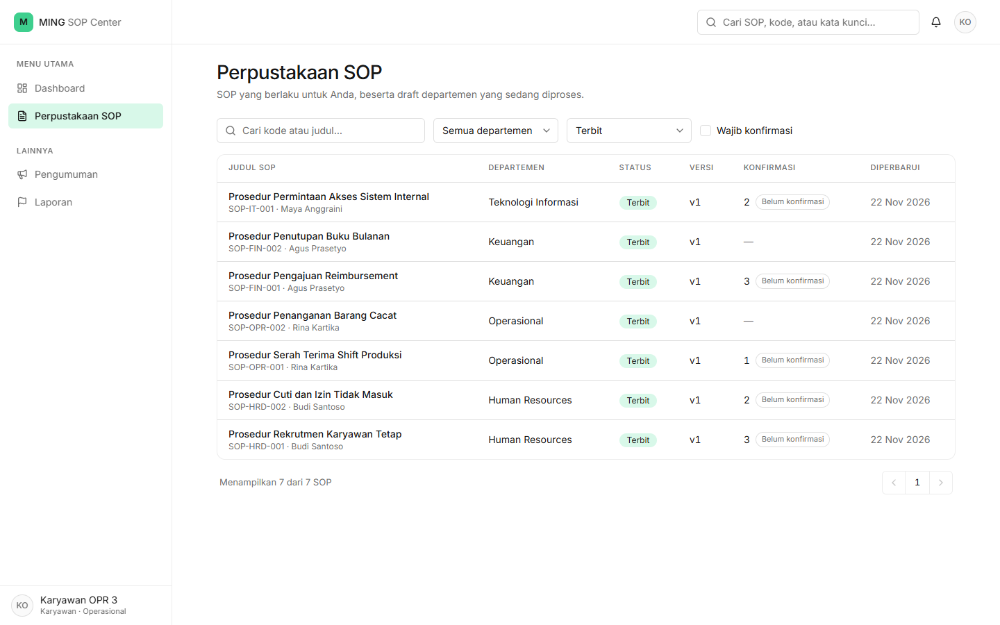

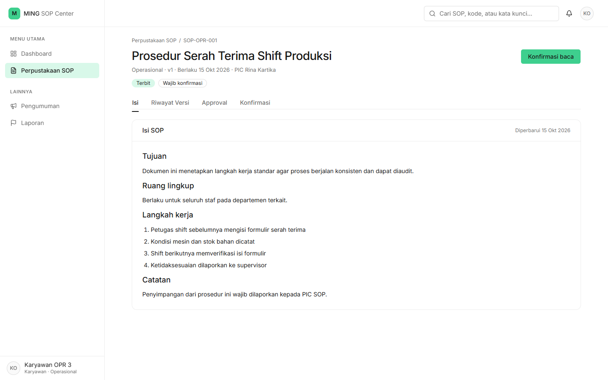

**Setelah dikonfirmasi**, tombol berubah menjadi keterangan "Anda sudah mengonfirmasi versi ini" dan notifikasi hijau muncul. Konfirmasi hanya dihitung sekali per versi.

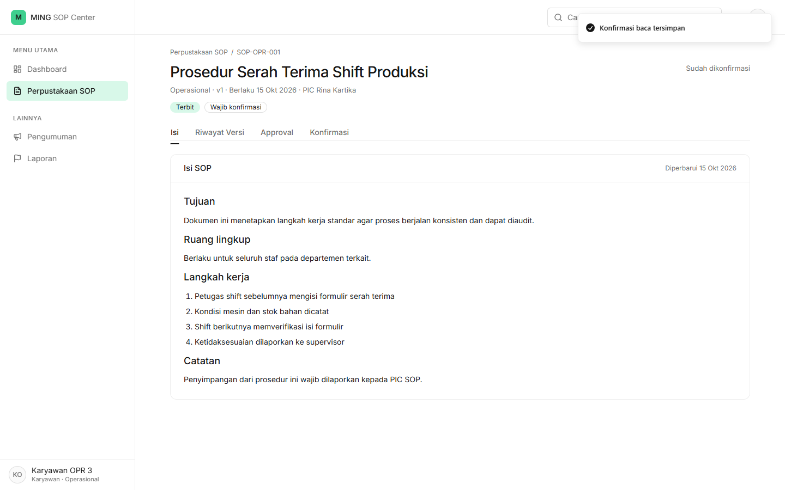

**Sub-bagian: Melaporkan dugaan pelanggaran**

1. Buka **Laporan** → **Buat laporan**.
2. Pilih SOP terkait (opsional), tulis deskripsi minimal 20 karakter: kejadian, waktu, lokasi.
3. Aktifkan **Kirim sebagai anonim** bila identitas tidak ingin disimpan.
4. Tekan **Kirim laporan**.

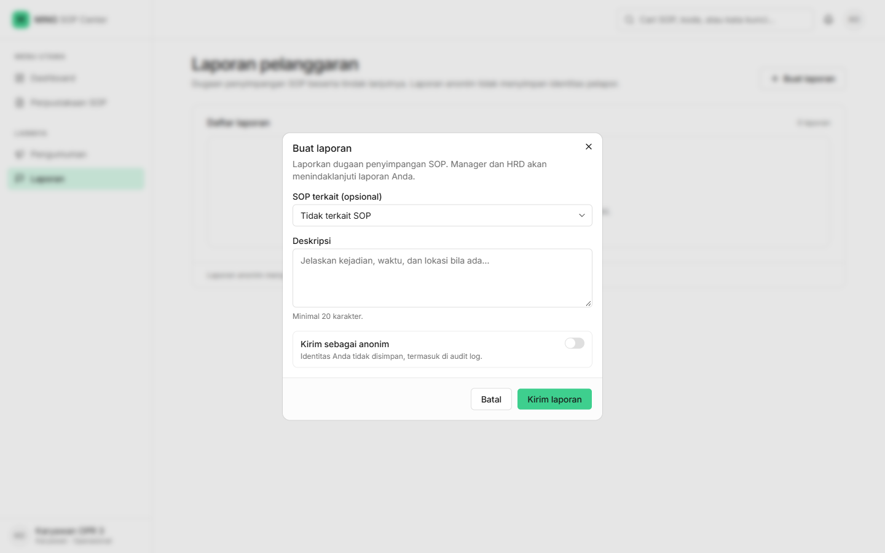

**Callout:** "Laporan anonim tidak dapat Anda lihat kembali setelah dikirim, karena identitas pelapor tidak disimpan."

**Sub-bagian: Pengumuman** — buka menu **Pengumuman**; pengumuman untuk departemen Anda dan untuk semua departemen tampil di sini.

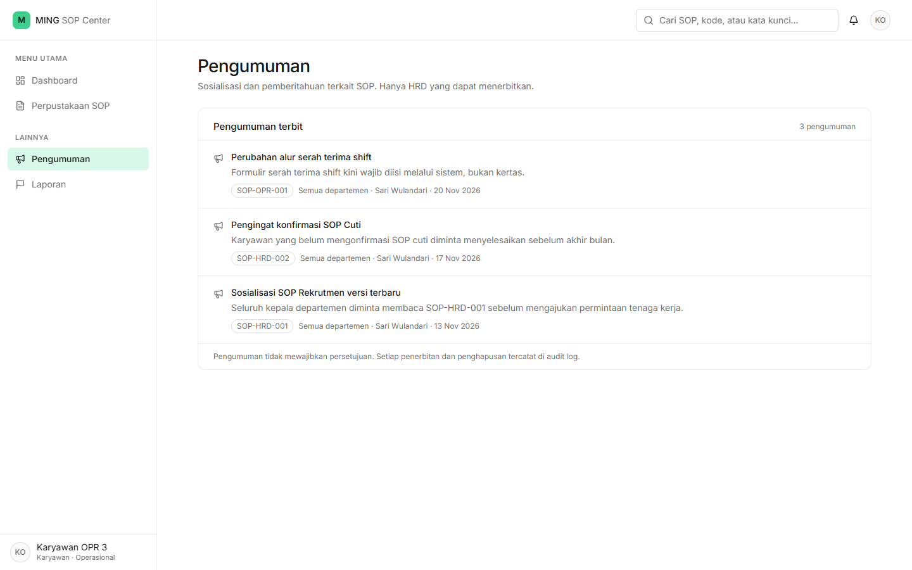

**Batasan yang harus disebut:** tidak ada notifikasi saat SOP baru terbit; karyawan perlu membuka aplikasi.

---

### 4.3 PIC SOP — menyusun dan menerbitkan versi

**Judul artikel:** "Menyusun SOP dan mengajukan review"
**Badge:** PIC SOP

**Langkah membuat SOP baru:**

1. Buka **Perpustakaan SOP** → **Buat SOP** (tombol hanya muncul untuk PIC SOP).
2. Isi kode SOP dengan pola `SOP-XXX-001`; kode harus unik.
3. Isi judul, ringkasan, periode tinjau ulang, dan centang **Wajib konfirmasi baca** bila perlu.
4. Tulis isi SOP dalam Markdown; pratinjau di kanan ikut berubah.
5. Pilih **Simpan** (tetap Draft) atau **Ajukan review** (langsung Menunggu persetujuan).

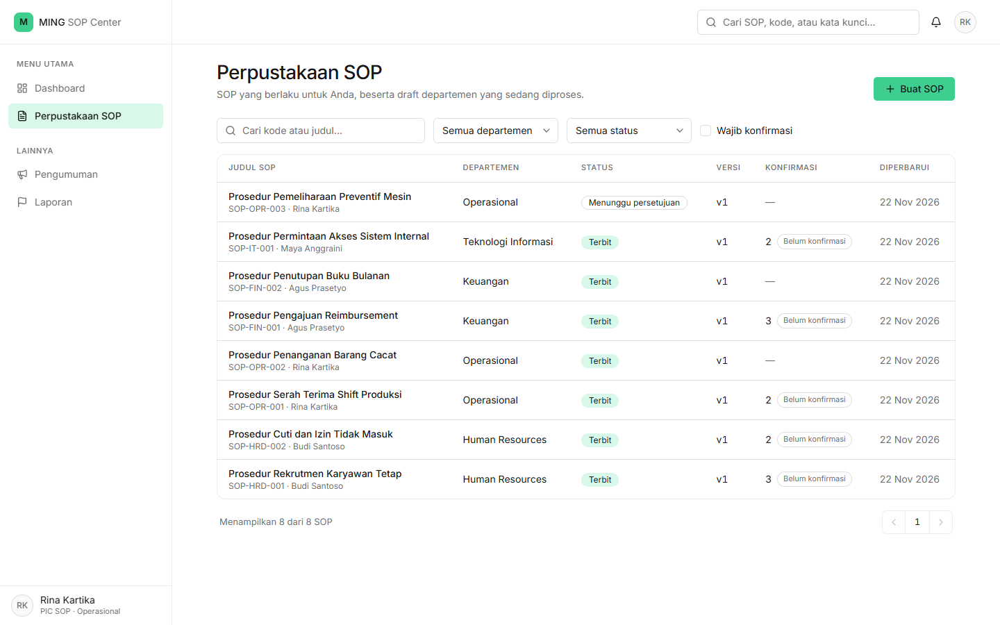

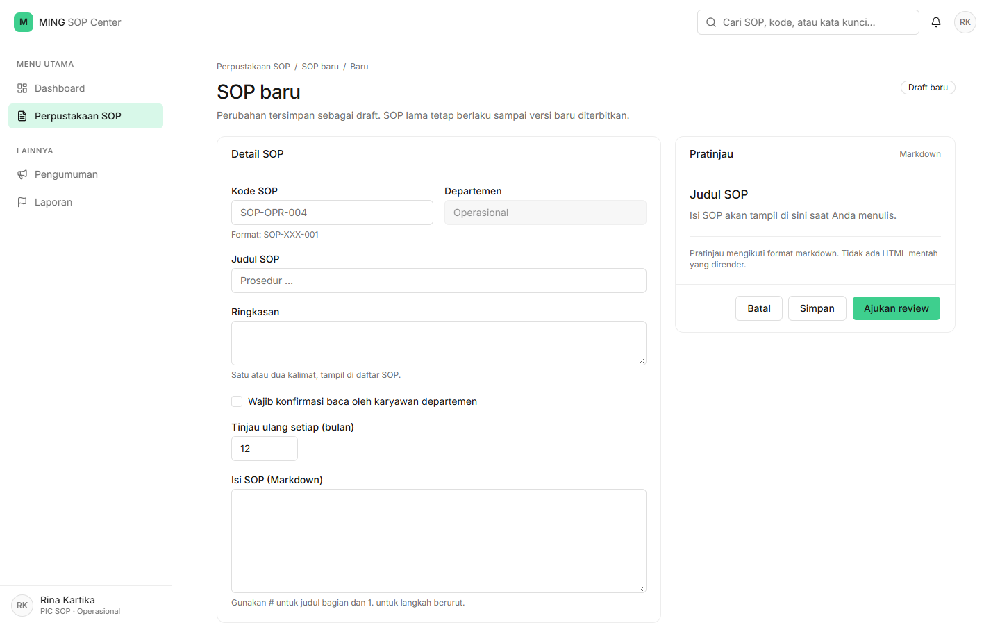

**Langkah menyunting SOP yang sudah terbit:**

1. Buka SOP terbit → **Buat versi baru**.
2. Isi ringkasan perubahan minimal 10 karakter → versi draft baru terbentuk.
3. Sunting isi draft, lalu **Ajukan review**.
4. Setelah Manager menyetujui dan HRD menerbitkan, versi lama otomatis berstatus **Digantikan**.

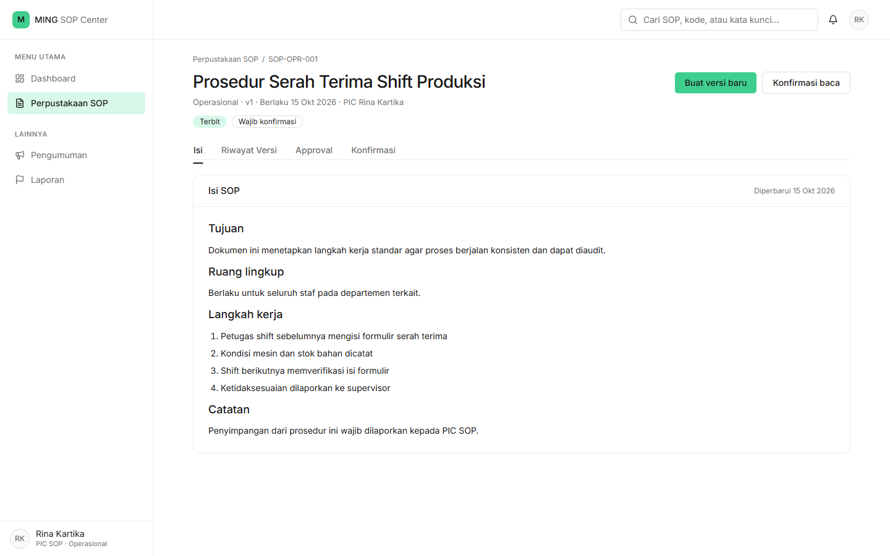

**Callout:** "SOP berstatus Terbit tidak bisa disunting langsung. Perubahan selalu lewat versi baru, dan konfirmasi karyawan dihitung ulang saat versi baru terbit."

---

### 4.4 Manager — meninjau dan memutuskan

**Judul artikel:** "Meninjau dan menyetujui SOP"
**Badge:** Manager

**Langkah:**

1. Dashboard menampilkan SOP departemen Anda yang **Menunggu persetujuan**.
2. Buka SOP → baca isi dan tab **Riwayat Versi**.
3. Tekan **Setujui** untuk meneruskan ke HRD, atau **Tolak** dengan alasan minimal 10 karakter.
4. Bila ditolak, SOP kembali ke **Draft** dan PIC dapat memperbaiki lalu mengajukan ulang.

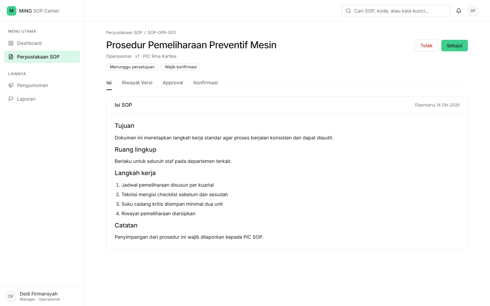

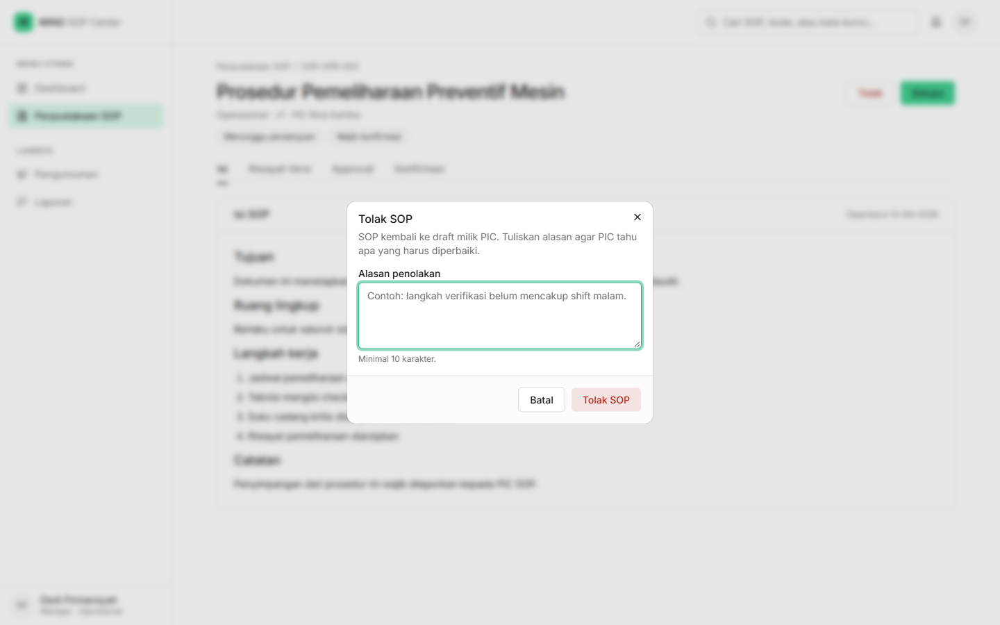

**Batasan yang harus disebut:** Manager hanya dapat menyetujui SOP dari departemennya sendiri; SOP departemen lain tidak muncul di antreannya.

**Tugas lain:** menindaklanjuti laporan pelanggaran (lihat 4.5, langkahnya sama untuk Manager dan HRD).

---

### 4.5 HRD — menerbitkan dan menindaklanjuti

**Judul artikel:** "Menerbitkan SOP dan menindaklanjuti laporan"
**Badge:** HRD

**Menerbitkan:**

1. Buka SOP berstatus **Siap terbit**.
2. Tekan **Terbitkan**, pilih **Tanggal berlaku**.
3. Konfirmasi. Status berubah menjadi **Terbit** dan tanggal tinjau ulang dihitung dari tanggal berlaku.

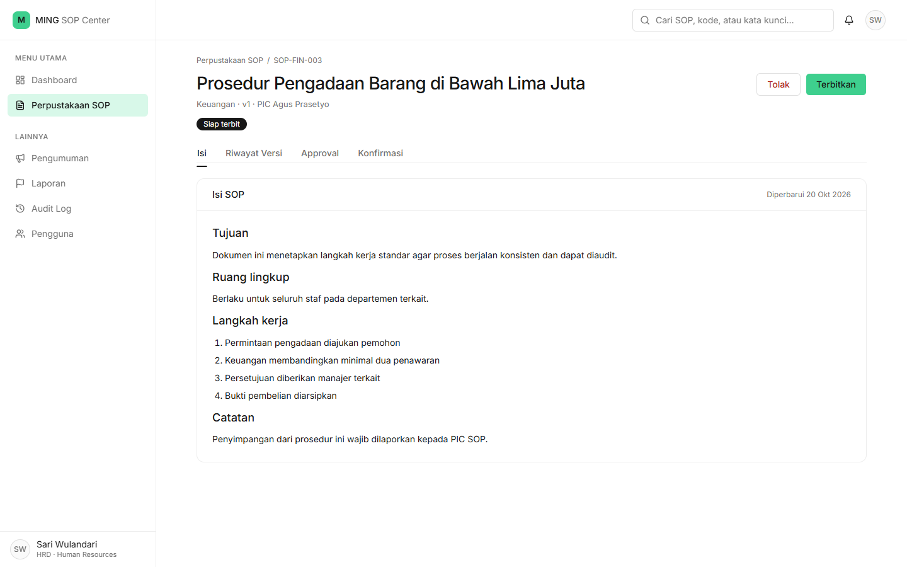

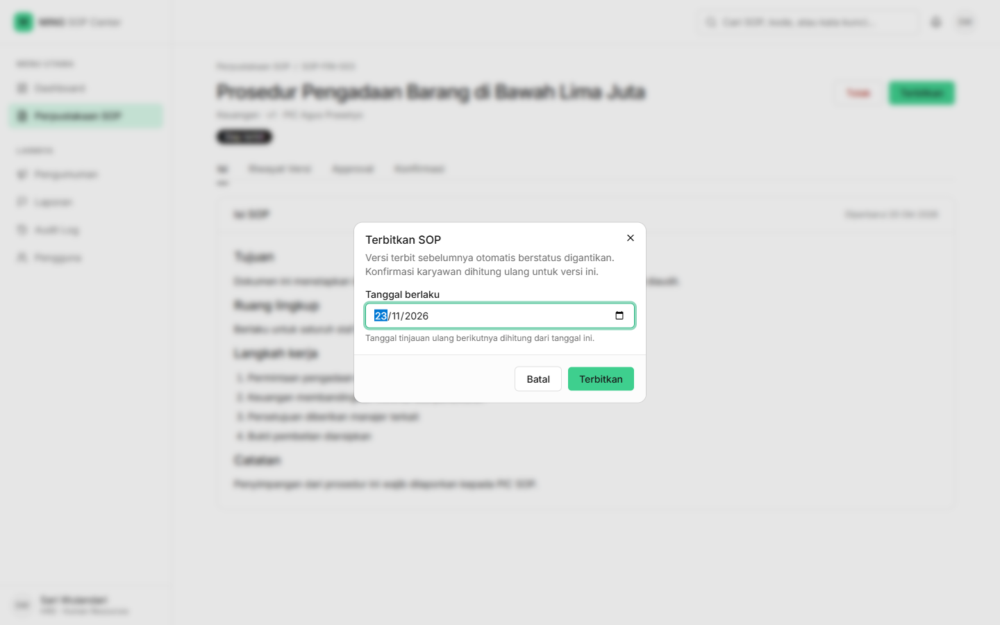

**Pengumuman:** buka **Pengumuman**, isi judul dan isi, pilih sasaran (semua departemen atau satu departemen), lalu **Terbitkan**.

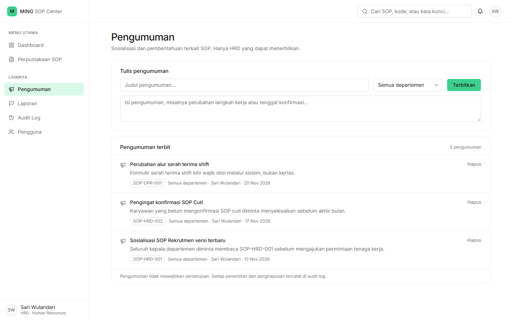

**Tindak lanjut laporan:**

1. Buka **Laporan**, pilih laporan di daftar kiri.
2. Pilih status baru: `OPEN → TRIAGED → INVESTIGATING → RESOLVED → CLOSED`.
3. Tulis catatan minimal 5 karakter, lalu **Simpan tindak lanjut**.
4. Setiap perubahan tersimpan sebagai riwayat baru dan tercatat di audit log.

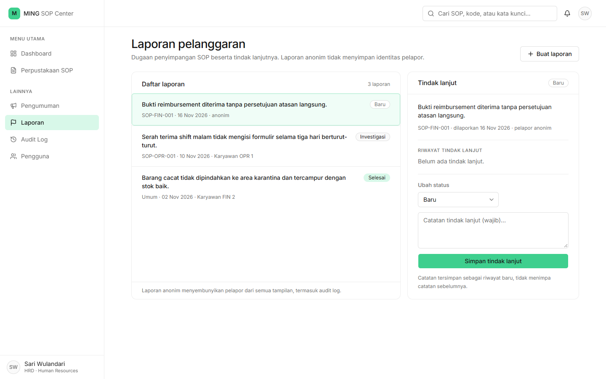

**Batasan yang harus disebut:** tidak ada modul Surat Peringatan. Keputusan sanksi dicatat sebagai catatan tindak lanjut, bukan sebagai data terstruktur.

---

### 4.6 Auditor — menelusuri riwayat

**Judul artikel:** "Menelusuri riwayat dan temuan"
**Badge:** Auditor

**Langkah:**

1. Buka **Audit Log**; saring berdasarkan aksi, jenis entitas, atau pelaku.
2. Klik satu baris untuk melihat nilai sebelum dan sesudah perubahan.
3. Buka **Pengguna** untuk melihat daftar akun, peran, dan departemen.

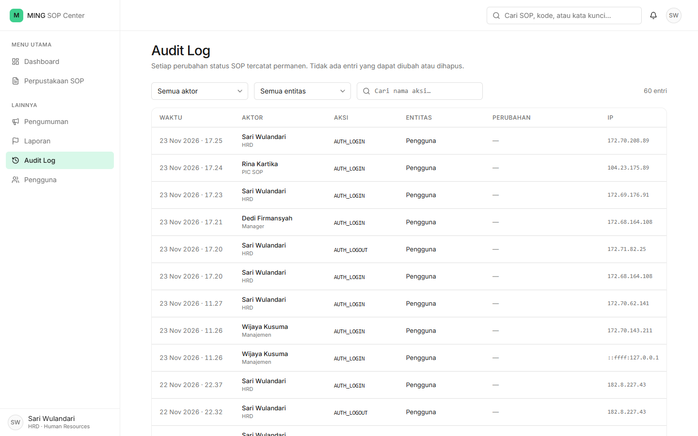

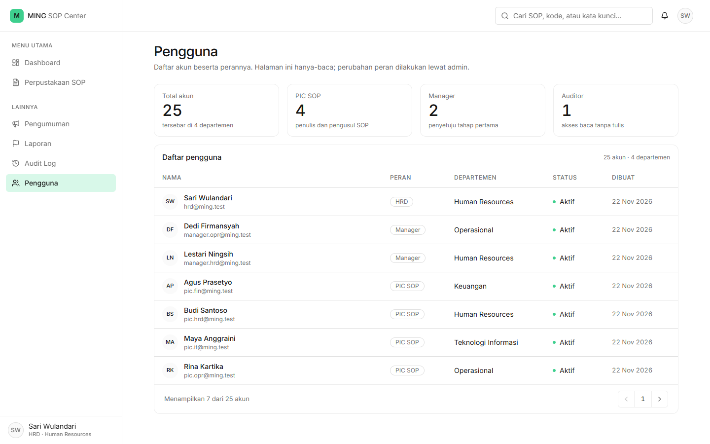

**Batas peran:** Auditor tidak dapat mengonfirmasi baca, menyetujui, menerbitkan, atau menindaklanjuti laporan. Halaman yang bukan haknya menampilkan **Akses ditolak**.

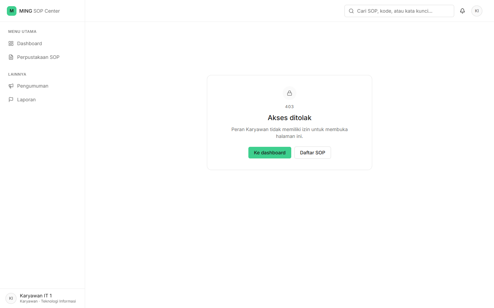

**Callout:** "Audit log tidak dapat diubah atau dihapus dari aplikasi, termasuk oleh HRD."

---

### 4.7 Manajemen — membaca ringkasan

**Judul artikel:** "Membaca ringkasan dan pekerjaan tertunda"
**Badge:** Manajemen

**Langkah:**

1. Dashboard menampilkan SOP terbit, kepatuhan konfirmasi, dan pengumuman terbaru.
2. Buka **Perpustakaan SOP** untuk membaca isi SOP; gunakan pencarian di header.
3. Bagian **Kepatuhan terendah** menunjukkan SOP yang paling sedikit dikonfirmasi.


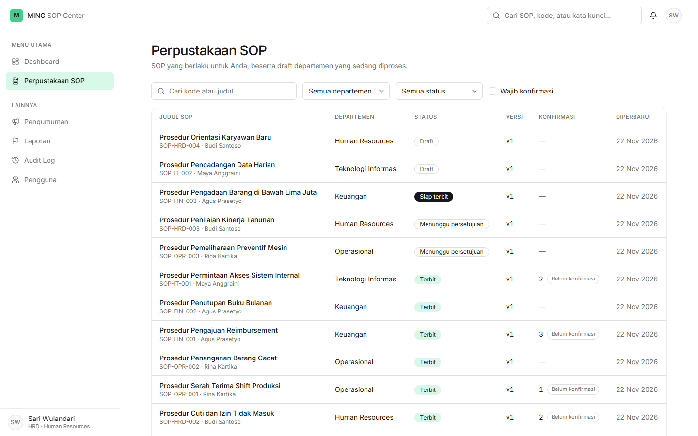

**Batas peran:** Manajemen bersifat hanya-baca — tidak ada tombol setujui, terbitkan, atau konfirmasi. Kartu "Menunggu tindakan" dan "Perlu konfirmasi" tidak relevan untuk peran ini.

---

### 4.8 Status & istilah — semua peran

**Isi tabel status** (label diambil dari `shared/src/index.ts`, bukan karangan):

| Status | Arti | Yang mengubah |
|---|---|---|
| Draft | Sedang disusun PIC SOP, belum diajukan | PIC SOP |
| Menunggu persetujuan | Sudah diajukan, menunggu keputusan Manager | Manager (setujui/tolak) |
| Siap terbit | Disetujui Manager, menunggu penerbitan | HRD |
| Terbit | Berlaku dan dapat dibaca seluruh karyawan | — |
| Digantikan | Versi lama setelah versi baru terbit | otomatis |
| Diarsipkan | Tidak berlaku lagi | HRD (belum ada di UI) |

**Istilah:**

- **Versi** — setiap penerbitan menghasilkan nomor versi baru; isi versi lama tidak pernah ditimpa.
- **Konfirmasi baca** — pernyataan karyawan bahwa ia sudah membaca versi yang berlaku; dihitung sekali per versi.
- **Kepatuhan** — persentase karyawan departemen yang sudah mengonfirmasi, dibanding jumlah karyawan aktif (di luar Auditor dan Manajemen).
- **Audit log** — catatan tindakan penting: siapa, kapan, apa yang berubah.
- **PIC SOP** — pemilik SOP di departemen; satu-satunya peran yang dapat menyusun SOP.


**Catatan:** "Diarsipkan" ada di tipe data tetapi belum ada tombolnya di aplikasi. Sebutkan sebagai belum tersedia, jangan digambarkan seolah bisa dipakai.

---

## 5. Inventaris screenshot

Semua diambil **2026-11-23** dari instance daring `https://sopming.arnoldartworks.my.id`, viewport 1440×900, data seed, akun demo. Kolom IP pada audit log sudah disamarkan.

| File | Isi | Status | Dipakai di |
|---|---|---|---|
| `screenshots/01-login.png` | Halaman masuk + akun demo | ada | 4.1 |
| `screenshots/02-dashboard-hrd.png` | Dashboard HRD | ada | 4.1, 4.7 |
| `screenshots/03-daftar-sop.png` | Daftar SOP + pill status | ada | 4.7, 4.8 |
| `screenshots/05-form-sop.png` | Form SOP + pratinjau | ada | 4.3 |
| `screenshots/06-laporan-tindak-lanjut.png` | Laporan + panel tindak lanjut | ada | 4.5 |
| `screenshots/07-audit-log.png` | Audit log (IP disamarkan) | ada | 4.6 |
| `screenshots/08-pengguna.png` | Daftar pengguna | ada | 4.6 |
| `screenshots/panduan/daftar-berlaku.png` | Daftar SOP difilter Terbit (karyawan) | **baru** | 4.2 |
| `screenshots/panduan/detail-konfirmasi.png` | Tombol **Konfirmasi baca** | **baru** | 4.2 |
| `screenshots/panduan/setelah-konfirmasi.png` | Keadaan setelah konfirmasi | **baru** | 4.2 |
| `screenshots/panduan/dialog-laporan.png` | Dialog **Buat laporan** + toggle anonim | **baru** | 4.2 |
| `screenshots/panduan/pengumuman-karyawan.png` | Pengumuman sisi karyawan | **baru** | 4.2 |
| `screenshots/panduan/pic-daftar.png` | Tombol **Buat SOP** | **baru** | 4.3 |
| `screenshots/panduan/pic-detail-buat-versi.png` | **Buat versi baru** pada SOP terbit | **baru** | 4.3 |
| `screenshots/panduan/manager-detail-review.png` | **Setujui** + **Tolak** | **baru** | 4.4 |
| `screenshots/panduan/manager-dialog-tolak.png` | Dialog penolakan | **baru** | 4.4 |
| `screenshots/panduan/hrd-detail-terbitkan.png` | **Terbitkan** pada Siap terbit | **baru** | 4.5 |
| `screenshots/panduan/hrd-dialog-terbit.png` | Dialog tanggal berlaku | **baru** | 4.5 |
| `screenshots/panduan/hrd-pengumuman.png` | Form pengumuman | **baru** | 4.5 |
| `screenshots/panduan/akses-ditolak.png` | Halaman 403 | **baru** | 4.6 |

Catatan reproduksibilitas: saat mengambil `detail-konfirmasi`, akun `karyawan3.opr@ming.test` ikut menekan konfirmasi sehingga datanya berubah. Untuk mengulang pengambilan gambar yang sama, pakai akun karyawan lain yang belum mengonfirmasi atau jalankan ulang seed.

---

## 6. Rencana implementasi (fase berikutnya, setelah disetujui)

| Keputusan | Pilihan | Alasan |
|---|---|---|
| Rute | `/panduan` di `client/src/App.tsx` | Statis, tanpa data server |
| Menu | Item **Panduan** (ikon `BookOpen`) di grup LAINNYA setelah **Pengguna**, semua peran | Sesuai desain; tidak butuh permission baru |
| Sumber konten | `client/src/content/panduan.ts` berupa array bagian + artikel | Satu sumber untuk TOC dan isi; mudah dikoreksi tanpa menyentuh JSX |
| Gambar | `client/public/panduan/*.png`, nama file sama dengan tabel §5 | Path stabil saat build |
| Daftar isi | Dirender dari data, anchor `#memulai` … `#status-istilah` | Tidak perlu router tambahan |
| Otorisasi | Tidak ada permission baru; halaman hanya-baca untuk semua peran | Server tidak berubah |
| Dependency | Tidak menambah paket | Konten statis |

**Perkiraan:** 2–3 jam.
**Urutan kerja:** salin 13 screenshot → tulis data konten 8 bagian → komponen halaman + TOC → daftarkan rute & menu → build → verifikasi.

**Berkas yang akan disentuh:** `client/src/content/panduan.ts` (baru), `client/src/pages/PanduanPage.tsx` (baru), `client/src/App.tsx`, `client/src/lib/nav.ts`, `client/public/panduan/` (13 gambar). Tidak ada perubahan di `server/` maupun `shared/`.

---

## 7. Kriteria selesai

- [ ] Delapan bagian di daftar isi semuanya punya isi; tidak ada tautan mati.
- [ ] Setiap langkah menyebut label tombol yang benar-benar ada di UI (dicek satu per satu ke komponen).
- [ ] Tidak ada klaim fitur yang belum ada (sanksi, notifikasi, lampiran, reset password, arsip).
- [ ] Semua gambar tampil dan tidak pecah; tidak ada IP publik yang terlihat.
- [ ] Menu **Panduan** muncul untuk enam peran; tidak memicu 403.
- [ ] `npm run build` keluar 0; `npm test` tetap 23/23.
- [ ] Tampilan konsisten dengan `DESIGN.md`: Inter, emerald sebagai satu-satunya warna aksen, kartu tanpa shadow.

---

## 8. Risiko

| Risiko | Dampak | Mitigasi |
|---|---|---|
| Data demo berubah (mis. SOP-OPR-003 disetujui saat demo) | Screenshot tidak bisa diulang persis | Simpan salinan gambar; jangan andalkan seed untuk reproduksi |
| UI berubah setelah panduan ditulis | Label tombol tidak cocok | Verifikasi label di akhir; panduan ditulis setelah UI stabil |
| Panduan menjanjikan fitur yang tidak ada | Penilai menguji dan gagal | Daftar batasan di §4 dipakai sebagai sumber; review terakhir terhadap README |
| Halaman baru menambah item nav di semua layar | Sidebar berubah dari desain lama | Desain sudah mengantisipasi (item Panduan ada di 13 frame) |

---

## 9. Yang sengaja tidak dikerjakan

- Pencarian di dalam panduan, anchor per langkah, tombol cetak/PDF.
- Versi mobile khusus (halaman mengikuti layout responsif yang ada).
- Video atau animasi di dalam aplikasi.
- Menerjemahkan panduan ke bahasa Inggris.
- Mengubah `sop.fig` — desain dianggap final.
